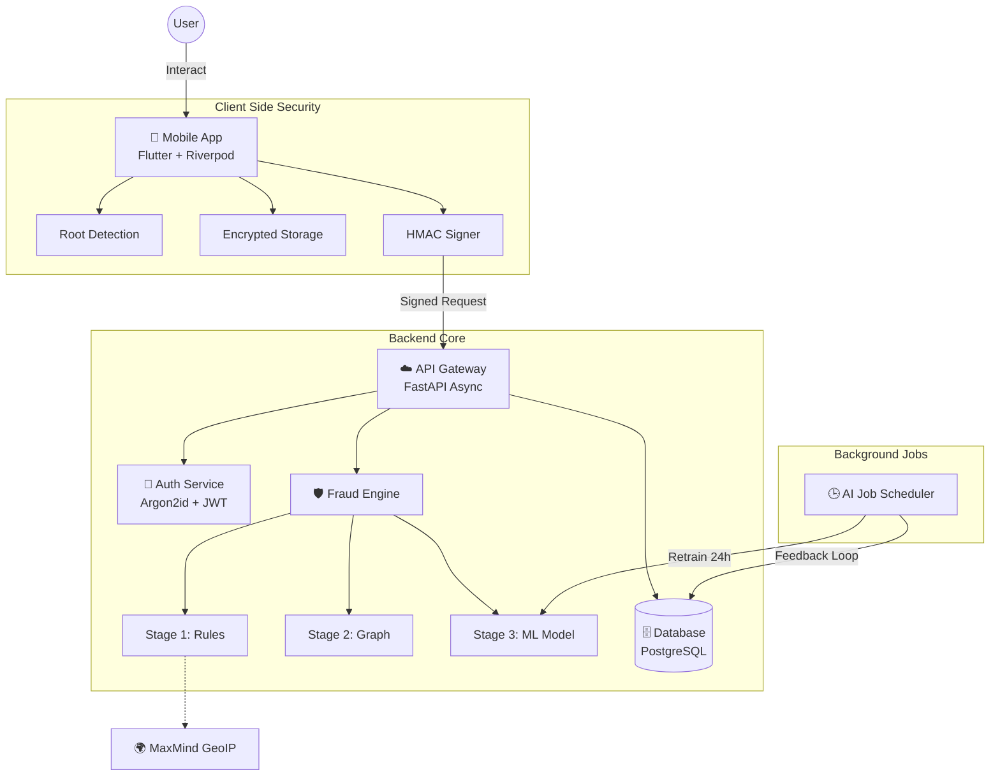

<div align="center">

  

  <h1 style="font-size: 3.5rem; margin: 20px 0; font-weight: 800; letter-spacing: -1px;">Safe Pay</h1>

  <p style="font-size: 1.3rem; max-width: 700px; margin: 0 auto; line-height: 1.6; color: #666;">
    <strong>Military-Grade Secure UPI Ecosystem</strong><br>
    Built for Trust. Powered by AI. Fortified by Cryptography.
  </p>

  <br>

  <div style="display: flex; gap: 10px; justify-content: center; flex-wrap: wrap;">
    
    
    
    
    
  </div>

  <br>

  <p>
    <a href="#-quick-start">🚀 Quick Start</a> •
    <a href="#-system-architecture">🏗️ Architecture</a> •
    <a href="#-security-arsenal">🔒 Security</a> •
    <a href="#-ai-engine">🧠 AI Engine</a> •
    <a href="project_documentation.html"><strong>📚 Full Documentation</strong></a>
  </p>

</div>

<br>
<hr>

## 🔬 The "Truth" Architecture
**Safe Pay** is a **production-grade payment ecosystem** simulation. Unlike typical mockups, this project implements the *actual* security & fraud detection protocols used by major sophisticated fintech unicorns.

> **Verification Challenge:** Inspect `backend/security.py`. We don't just *say* we use AES-256; we implemented `cryptography.Fernet` with key rotation. Check `backend/fraud_engine.py` to see the **Champion-Challenger** model retraining logic.

---

## 🔒 Security Arsenal

We strictly adhere to a **Zero Trust** security model.

| Layer | Technology | Implementation Details |
|:------|:-----------|:-----------------------|
| **Data at Rest** | **AES-256 (Fernet)** | All PII (Phone, Email, Balance, Messages) is strictly encrypted. Even DB admins see only ciphertext. |
| **Authentication** | **Argon2id** | Passwords & PINs are hashed using the winner of the Password Hashing Competition. Resistant to GPU/ASIC attacks. |
| **Integrity** | **HMAC-SHA256** | Every API request is digitally signed. Modifying a single byte of the payload invalidates the request. |
| **Session** | **Token Rotation** | JWT Access Tokens (15m) + Single-Use Refresh Tokens (7d). Used logic detects token theft attempts. |
| **Device** | **Binding** | Accounts are cryptographically bound to a unique device ID. Logging in elsewhere auto-revokes the old binding. |
| **Mobile** | **Jailbreak Detection** | App refuses to launch on rooted/jailbroken devices to prevent memory scraping and hook attacks. |

---

## 🧠 AI Fraud Engine (The Brain)

Inspired by **Google Pay's Risk Engine**, our system evaluates every transaction through a 3-stage funnel:

### Stage 1: The Reflexes (Hard Rules) ⚡
**54+ Deterministic Rules** execute in <10ms.
-   **Velocity Checks**: "5 transactions in 10 minutes?" → **BLOCK**
-   **Geo-Velocity**: "Login in Mumbai, then 5 mins later in London?" → **BLOCK** (Impossible Travel)
-   **Amount Spikes**: "User usually sends ₹500, now sending ₹50,000?" → **FLAG**

### Stage 2: The Network (Social Graph) 🕸️
**Graph-Based Trust Analysis**.
-   **Trust Score**: Friends (Depth 1) have higher trust limits than Strangers (Depth 0).
-   **Feedback Loop**: Successful transactions slowly increase the trust score between two nodes.

### Stage 3: The Brain (Anomaly Detection) 🤖
**Unsupervised Learning** using `IsolationForest` & `XGBoost`.
-   **28+ Features**: Analyzes keystroke dynamics (proxy), session timing, spending patterns, and device behavior.
-   **Champion-Challenger**: The system trains a new model every 24 hours. The new model challenges the old one; if it performs better (higher AUC), it is promoted to production automatically.

---

## 🏗️ System Architecture

A decoupled, scalable microservices approaches using Async I/O.



---

## 🚀 Quick Start

Get the "Truth" environment running in under 5 minutes.

### 1. Backend Setup
```bash
# 1. Clone & Enter
git clone https://github.com/Dhanush-M2005/SafePay.git
cd SafePay/backend

# 2. Virtual Env
python -m venv .venv
source .venv/bin/activate  # Windows: .venv\Scripts\activate

# 3. Install & Run
pip install -r requirements.txt
uvicorn main:app --reload --host 0.0.0.0 --port 8000
```

### 2. Mobile App Setup
```bash
cd ../mobile_app

# 1. Get Packages
flutter pub get

# 2. Configure Endpoint
# Open lib/services/api_client.dart -> Update `baseUrl` to your local IP

# 3. Launch
flutter run
```

---

## 📱 Mobile App Experience

The Flutter app isn't just a shell; it's a fully engineered client.

-   **Dark Mode**: "True Black" OLED optimized theme.
-   **Biometrics**: Ready for FaceID/Fingerprint integration.
-   **Real-Time**: Lottie animations for "Processing Shield" visualization.
-   **Offline-First**: Caches balance and history for instant load times.

---

## 📊 Project Statistics

| Metric | Count | Details |
|:-------|:-----:|:--------|
| **Lines of Code** | ~5,200+ | Python (Backend) + Dart (Mobile) |
| **API Endpoints** | 18+ | Fully documented in Swagger |
| **Database Tables** | 14 | Normalized schema with foreign keys |
| **Fraud Rules** | 54 | Hardcoded logic patterns |
| **AI Features** | 28 | Dimensions for anomaly detection |

---

## 📄 License & Attribution

This project is proprietary software developed for high-end demonstration purposes. 
**Copyright © 2026 SafePay Team.**

<br>

<div align="center">
  <sub>Built with precision by the SafePay Engineering Team</sub>
</div>